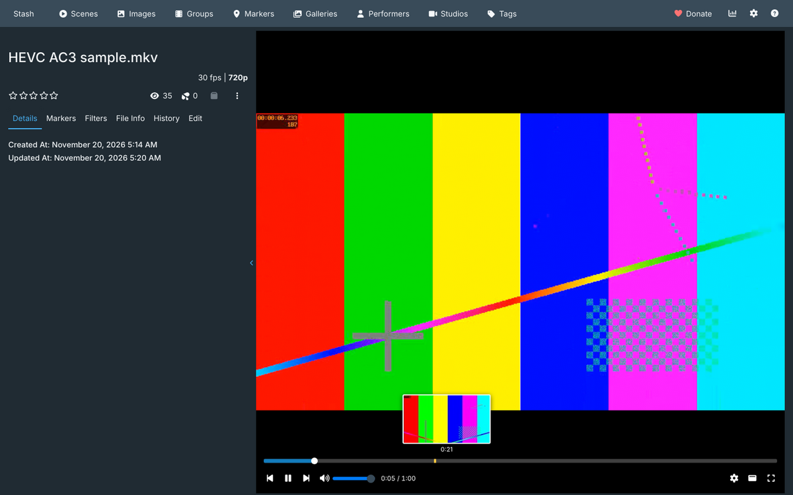

# Stash Native Player

A desktop app for [Stash](https://github.com/stashapp/stash) that keeps Stash's
own web interface but plays videos with an embedded **mpv** player instead of
the browser's `<video>` element.

- Plays almost any codec/container directly (HEVC/x265, AV1, VC-1, MKV, AVI,
  WMV, AC3/DTS/TrueHD audio, …) with hardware decoding, so Stash never has to
  live-transcode for playback.
- Same UI as the browser: the player sits in the normal spot on the scene page,
  with a seek bar with sprite thumbnail previews, marker ticks, speed / audio /
  subtitle track menus, resume position and play count syncing.
- **Fill window** mode: one click (or `T`) makes the player cover the whole app
  window; `Esc` returns to the page.
- Stash itself is not modified. The server only needs a small UI plugin, which
  does nothing in a normal browser.

```
┌──────────── app window ────────────┐
│  Stash web UI (Qt WebEngine)       │  ← page is transparent where the video is,
│  ┌──────────────────────────┐      │    HTML controls are drawn on top
│  │   (transparent hole)     │      │
│  └──────────────────────────┘      │
├────────────────────────────────────┤
│  mpv video, drawn underneath       │  ← libmpv, OpenGL render API
└────────────────────────────────────┘
```

| Scene page | Fill window |
|---|---|
|  |  |

<sub>Screenshots from the Linux test setup with generated test videos (HEVC/AC3 MKV, H.264 MP4).</sub>

## Parts

| Folder | What |
|---|---|
| `plugin/StashNativePlayer/` | Stash UI plugin. Inside the app it replaces the `ScenePlayer` component with a thin HTML control layer that drives mpv through a Qt WebChannel bridge. In a normal browser it is inert. |
| `app/` | The desktop app (C++17, Qt 6.8 Quick + WebEngine, libmpv loaded at runtime). |

## Install

### 1. Plugin (on the Stash server)

Copy `plugin/StashNativePlayer` into Stash's `plugins` folder (by default the
`plugins` folder next to Stash's `config.yml`, e.g. `~/.stash/plugins`), then in
Stash open **Settings → Plugins → Reload plugins**.

```
~/.stash/plugins/StashNativePlayer/StashNativePlayer.yml
~/.stash/plugins/StashNativePlayer/native-player.js
~/.stash/plugins/StashNativePlayer/native-player.css
~/.stash/plugins/StashNativePlayer/snp_captions.py
```

`snp_captions.py` is the server side of subtitle generation (see "Whole-video
subtitles" below). It runs with Stash's Python (`python3`, or Settings →
System → Python executable path), uses only the standard library, and needs
write access to the folders the videos are in. The player itself works
without it.

### 2. App (on the computer you watch on)

Download the zip for your system from the
[latest release](https://github.com/victoruptons/stash-native-player/releases/latest):

- **Windows:** `StashNativePlayer-windows-x64.zip`. Unzip it and run
  `StashNativePlayer.exe`.
- **macOS (Apple Silicon):** `StashNativePlayer-macos-arm64.zip`. Unzip it and
  move `StashNativePlayer.app` to Applications. The app isn't notarized, so the
  first time, right-click it → **Open** (or run
  `xattr -dr com.apple.quarantine /Applications/StashNativePlayer.app`). The
  macOS build is new and not yet tested on a real Mac. Subtitles there need
  `ffmpeg`, `whisper-cpp` and `llama.cpp` from Homebrew; burned-in subtitle
  detection is Windows-only.

On first start, enter your Stash address (e.g. `http://192.168.1.10:9999`).

To switch servers later, click the address on the right of the toolbar: it
lists recently used servers and has "Other address…". Starting the app with
`--server <address>` opens that server for one run without changing the saved
address (useful for a test server).

If Stash has a username/password, log in inside the app as usual. The login
cookie is passed to mpv for the video stream. An API key also works: Stash puts
it in the stream URL itself.

## Using it

| Key / action | |
|---|---|
| Click video, `Space` | Play / pause |
| `←` / `→` (`Shift`: 30 s) | Seek 5 s |
| Mouse wheel over the video | Seek 1 s per notch (down = forward, up = back) |
| `↑` / `↓` | Volume |
| `M` | Mute |
| `T` or the window button | Fill window (`Esc` to exit) |
| `F`, double-click | Fullscreen |
| Hover the seek bar | Thumbnail preview (needs Stash's generated sprites) |
| ⚙ menu | Speed, audio track, subtitles |

The window has no native title bar. The toolbar at the top has back /
forward / reload, the server switcher and the window buttons; drag empty
toolbar space to move the window and double-click it to maximize. Windows
Snap (drag to a screen edge) and PowerToys FancyZones (`Shift`-drag) work
when dragging by the toolbar.

App shortcuts: `Ctrl+Shift+S` change server, `Ctrl+Shift+L` live subtitles, `F5`/`Ctrl+R` reload,
`Alt+←/→` back/forward, `Ctrl +/-/0` zoom, `F11` fullscreen.

### Live subtitles (字幕)

The **字幕** button in the toolbar (or `Ctrl+Shift+L`) turns on subtitles
generated while you watch: off / original language / Traditional Chinese
translation / both. Everything runs on this PC; no audio or text leaves it.

How it works: ffmpeg reads the playing file's audio in 30-second chunks,
up to a minute ahead of playback; a local **whisper.cpp** server (CUDA)
transcribes each chunk (about 0.5 s on an RTX 4090); a local **llama.cpp**
server with Qwen 2.5 7B translates the lines (about 1 s per batch); mpv draws
them on the video. After a seek, new lines appear within a second or two.
The first use after starting the app takes about 10 s while the models load.
The servers use roughly 7 GB of GPU memory and are stopped when subtitles are
turned off.

Speech recognition covers about 100 languages (whisper large-v3-turbo); the
translation model handles the major ones (English, Japanese, Korean, the
main European languages, ...) well and rarer ones less well. Chinese audio
is shown without translation.

The tools are not part of the build. They go in
`%LOCALAPPDATA%\StashNativePlayer\Stash Native Player\ai` (or the folder in
`SNP_AI_DIR`):

| Path | Get it from |
|---|---|
| `whisper\whisper-server.exe` + DLLs | [whisper.cpp releases](https://github.com/ggml-org/whisper.cpp/releases), `whisper-bin-win-cuda-12.4.0-x64.zip` (the CUDA 11.8 zip lacks cuBLAS and silently runs on the CPU). Use build b5907 or newer: older builds crash on audio without speech (music, silence) when VAD is on; the app restarts a crashed server, but subtitles pause meanwhile |
| `llama\llama-server.exe` + DLLs | [llama.cpp releases](https://github.com/ggml-org/llama.cpp/releases), `llama-<build>-bin-win-vulkan-x64.zip` |
| `ffmpeg\ffmpeg.exe` | any ffmpeg build (or ffmpeg on `PATH`) |
| `models\ggml-large-v3-turbo-q8_0.bin` | [ggerganov/whisper.cpp](https://huggingface.co/ggerganov/whisper.cpp) (any `ggml-*.bin` whisper model works) |
| `models\ggml-silero-v5.1.2.bin` | [ggml-org/whisper-vad](https://huggingface.co/ggml-org/whisper-vad) (optional; skips silence and cuts down made-up text) |
| `models\Qwen2.5-7B-Instruct-Q4_K_M.gguf` | [bartowski/Qwen2.5-7B-Instruct-GGUF](https://huggingface.co/bartowski/Qwen2.5-7B-Instruct-GGUF) (any instruct `.gguf`; without one, only the original-language mode works) |
| `models\Qwen3-30B-A3B-Instruct-2507-Q4_K_M.gguf` | optional, [Qwen3-30B-A3B-Instruct-2507 GGUF](https://huggingface.co/models?search=Qwen3-30B-A3B-Instruct-2507%20gguf): clearly better translations (keeps lines aligned, no Simplified characters, natural spoken Chinese) at the same speed, but needs about 17.5 GB of GPU memory |

**Models folder and model choice:** 字幕 menu → 字幕設定（模型） picks the
models folder (default `ai\models`; it can be anywhere, e.g. `D:\models`), the
speech model, and the translation model separately for **real-time**
subtitles and for **whole-video** generation (or 不翻譯 for either). Only one
translation model is loaded at a time, since two big ones don't fit in GPU
memory: real-time playback comes first, and a whole-video job that wants the
other model goes on transcribing, then waits to translate until playback has
nothing left to translate, and swaps models then. Translations are also
cleaned of junk small models sometimes produce (stray English words that are
not in the source line, runaway repetition).

With `SNP_DEBUG=1` the pipeline (each line, each translation batch) is
logged to `%TEMP%\snp-livesubs.log`.

If the scene already has captions in Stash, live subtitles show those instead
of transcribing (no speech model is started). If there is an original-language
caption but no Chinese one, only the translation runs.

#### Whole-video subtitles (saved in Stash)

Subtitles can also be made for whole videos ahead of time and saved in Stash,
so they are never generated twice and Stash's own player (in any browser) can
show them too:

- **Queue = the Stash tag `產生字幕`.** Tag scenes with it (one by one, or many
  at once with Stash's bulk edit on a selection). The app picks tagged scenes
  up within a few minutes (or now: 字幕 menu → 處理字幕佇列) and does them one
  at a time in the background while it is open. 字幕 menu → 產生整部字幕 tags
  the playing scene.
- For each scene: the whole audio track is read once, transcribed, translated,
  and the plugin's server task writes `<video name>.<lang>.srt` (original, e.g.
  `.en.srt`) and `<video name>.zh.srt` (Traditional Chinese) next to the video
  and scans them, so they show up as the scene's captions. Stash only accepts
  two/three-letter language codes, hence `zh`, not `zh-TW`.
- When done, the tag is removed. On failure the scene gets the tag
  `產生字幕失敗` instead (the reason is in the 字幕 button's tooltip); tag it
  `產生字幕` again to retry.
- Scenes that already have a Chinese caption are skipped. Ones with only an
  original-language caption (for example a downloaded `.en.srt`) are just
  translated.
- Existing caption files are never overwritten unless this plugin wrote them
  (it keeps a list in `snp_written.json`). To redo a scene, delete its
  `.zh.srt` (and `.<lang>.srt`), rescan, and tag it again.
- 字幕 menu → 暫停產生字幕 pauses the queue (kept across restarts).
- 字幕 menu → 所有沒有字幕的影片加入佇列 tags every scene that has no captions
  at all in one go, after showing how many there are, their total length and
  an estimated time. Scenes already queued, or tagged `產生字幕失敗`, `無對白`,
  `內嵌字幕`, `畫面字幕` or `略過字幕`, are left out. `無對白` is given to videos with no
  speech at all (nothing to save), so they are not queued again.
- Skips (字幕設定 → 預做字幕：跳過哪些影片), checked before the long work:
  - **內嵌字幕:** ffmpeg reads the file's track list (a fraction of a
    second). Skip files with any embedded subtitle track (default), only
    those with a Chinese one (language `chi`/`zho`/... or a title like
    繁體/简体/Chinese), or never.
  - **對白語言:** whisper names the spoken language from a 30 s sample at
    20 % of the video (then 50 %, 80 % if there is no clear speech); skip
    中文/英語/日語/韓語 and any other language codes (`fr,de`, ...).
  - **畫面字幕 (burned into the picture):** at up to 8 moments when whisper
    heard speech in those samples, ffmpeg grabs the bottom 30 % of the frame
    and the OCR engine built into Windows (Windows.Media.Ocr, the Chinese
    Traditional one if installed; no download, ~50 ms a frame) reads it.
    Text in at least 40 % of the frames, and different text in each (lines
    found in half the frames or more, such as logos, watermarks and channel
    names, are ignored), counts as burned-in subtitles; Chinese if most of
    those have Chinese characters. Skip Chinese ones (default), any, or
    never. Subtitles elsewhere on screen, or too small or stylized to read,
    are not seen.
  - Skipped scenes are tagged `內嵌字幕`, `畫面字幕` or `略過字幕` instead, so
    "all without subtitles" leaves them out. After changing the settings, remove
    the tag and queue them again to redo them.

### Tuning mpv

The app reads `mpv.conf` / `input.conf` from the `mpv` folder in its config
directory (on Windows `%LOCALAPPDATA%\StashNativePlayer\Stash Native Player\mpv`).
Use it for the usual mpv options, e.g.:

```
hwdec=auto-copy
profile=gpu-hq
audio-device=wasapi/{...}
```

## Building

Requirements: CMake ≥ 3.21, a C++17 compiler, Qt **6.8** with the
`qtwebengine`, `qtwebchannel` and `qtpositioning` modules, and libmpv.

libmpv is loaded at runtime, so only its headers are needed at build time.
Point `MPV_INCLUDE_DIR` at a folder containing `mpv/client.h`, or leave it
unset and CMake will download the headers.

Windows (from a "x64 Native Tools" prompt):

```bat
cmake -S app -B build -G Ninja -DCMAKE_BUILD_TYPE=Release -DCMAKE_PREFIX_PATH=C:\Qt\6.8.3\msvc2022_64 -DMPV_INCLUDE_DIR=C:\path\to\mpv-dev\include
cmake --build build
windeployqt --release --qmldir app\qml build\StashNativePlayer.exe
copy C:\path\to\mpv-dev\libmpv-2.dll build\
```

`libmpv-2.dll` and headers come from the `mpv-dev-x86_64-*.7z` archives at
[shinchiro/mpv-winbuild-cmake](https://github.com/shinchiro/mpv-winbuild-cmake/releases).
The GitHub Actions workflow in `.github/workflows/build.yml` does all of this
and uploads a ready-to-run folder.

macOS: install Qt 6.8 (with the same modules) and `brew install mpv`, then
`cmake -S app -B build -G Ninja -DCMAKE_BUILD_TYPE=Release` and
`cmake --build build`. The workflow's `macos` job shows how the libmpv
dylibs are bundled into the `.app`.

Linux (for development): install Qt 6 WebEngine dev packages and `libmpv-dev`,
then `cmake -S app -B build && cmake --build build`.

### Tests

- App: add `-DSNP_BUILD_TESTS=ON` when configuring, build, then run
  `ctest --test-dir build --output-on-failure` (on Windows, with Qt's `bin`
  folder on `PATH`). Covers the subtitle code in `app/src/subtitlecore.cpp`.
- Plugin: `python -m unittest discover -s plugin/tests -v` (Stash is faked;
  covers `snp_captions.py`).

GitHub Actions has two workflows. **ci** builds Windows and macOS and runs both
test suites on every push to `main` and on pull requests. **release** runs on
version tags (below). Both use the shared steps in `.github/workflows/build.yml`.

### Releasing

Versions follow [Semantic Versioning](https://semver.org): `MAJOR.MINOR.PATCH`.
Bump MINOR for new features, PATCH for fixes, MAJOR for breaking changes (for
example a plugin that no longer works with older apps). The app and the plugin
share one version. Changes are recorded in [CHANGELOG.md](CHANGELOG.md).

1. Move the items under `## [Unreleased]` in `CHANGELOG.md` into a new
   `## [X.Y.Z]` section.
2. Set the same version in `app/CMakeLists.txt` (`project(... VERSION X.Y.Z)`)
   and `plugin/StashNativePlayer/StashNativePlayer.yml` (`version:`).
3. Commit, then tag and push:
   `git tag vX.Y.Z` and `git push origin main vX.Y.Z`.

The release workflow checks that the tag matches both version numbers and has
a changelog section, builds and tests Windows, macOS and the plugin, and publishes a GitHub
release with the three zips and that section as release notes. A tag like
`vX.Y.Z-beta.1` is published as a pre-release.

### Troubleshooting environment variables

| Variable | Effect |
|---|---|
| `SNP_DEBUG=1` | Log bridge state / mpv property changes |
| `SNP_MPV_LOG=v` | mpv log level (`warn` by default; `v`, `debug`) |
| `SNP_QML=<file>` | Load a different QML file (development) |
| `SNP_NO_GPU_RASTER=1` | Don't force Chromium's GPU rasterization (it is otherwise turned on, since Chromium leaves it off with Qt's desktop OpenGL) |
| `SNP_NO_SNAP_FRAME=1` | Windows: plain Qt frameless window, without the native resizable/maximizable styles that Windows Snap and FancyZones need |
| `SNP_AI_DIR` | Folder with the live-subtitle tools and models (default `%LOCALAPPDATA%\StashNativePlayer\Stash Native Player\ai`) |
| `QT_FORCE_STDERR_LOGGING=1` | On Windows, print Qt/mpv logs to stderr (the app has no console) |

## How it works

- **Video layer.** `MpvItem` (`app/src/mpvitem.cpp`) uses mpv's OpenGL render API. It
  renders each frame into an offscreen framebuffer on Qt's render thread. At
  the start of the window's render pass, it blits that frame into the window
  at the player's position, before the web view is drawn. This is Qt's
  "OpenGL under QML" pattern. Qt Quick runs on the OpenGL backend for this.
  Before calling mpv the app resets the GL state Qt Quick leaves behind
  (depth/stencil/blend, masks, bound program/VAO/samplers). Without that,
  mpv's float intermediate passes corrupt two-plane frames (NV12/P010, i.e.
  every hardware-decoded video) into rows of colored speckles.
- **Transparent page.** The app marks every page with `html.snp-app` as soon
  as the document is created. The plugin's CSS then keeps the page root
  transparent and paints Stash's background on a fixed layer with a hole
  (`clip-path`) where the video is. The page root must be transparent from
  the first paint. Otherwise Chromium treats it as opaque and keeps stale
  pixels inside the hole.
- **Bridge.** `Bridge` (`app/src/bridge.cpp`) is exposed to the page as
  `stashNative` over Qt WebChannel. It only plays http(s) URLs on the
  configured Stash server.
- **Plugin.** It uses Stash's `PluginApi.patch.instead("ScenePlayer", …)`, the
  same props as the stock player (`sendSetTimestamp` for marker clicks,
  `onComplete`/`onNext`/`onPrevious` for queues), Stash's own GraphQL mutations
  for resume time and play count, and Stash's `useSpriteInfo` hook for seek
  thumbnails.

## Status

Built and tested end to end on Linux: Qt 6.8 with Mesa software rendering, a
real Stash v0.32 server, and H.264/AAC MP4 plus HEVC/AC3 MKV samples. Qt 6.4
compiles but its WebEngine doesn't composite the video layer correctly, so use
Qt 6.8 or newer. Windows: built locally with MSVC (VS Build Tools 18) and
Qt 6.8.3 and tested on an RTX 4090 against a local Stash v0.32 test server
(H.264, HEVC 10-bit 4K, AV1; nvdec hardware decoding). Known limitation: the
web view is capped at 60 fps by Qt WebEngine, so on high-refresh monitors
scrolling is less smooth than in a normal browser. macOS is planned.
